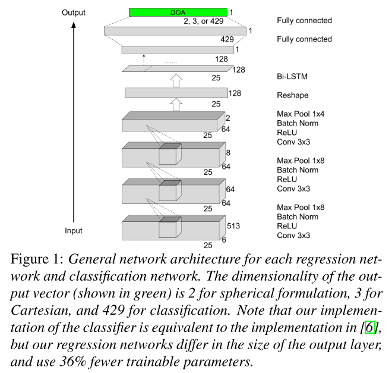
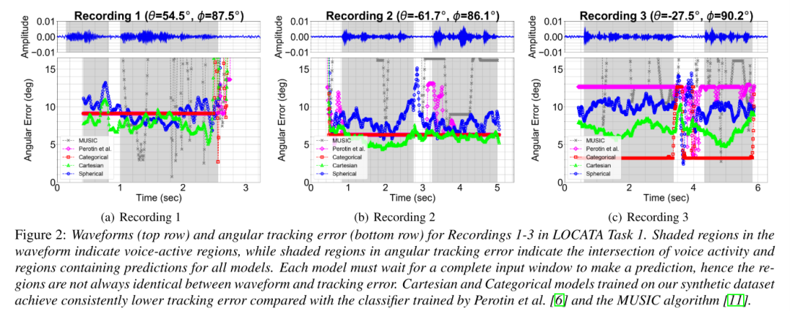

# [DOA Estimation] Recurrent Neural Network for Wave Direction Estimation with Regression and Classification [Attached Code]

Introduction: Estimation of Direction of Arrival (DOA) for Sound Sources has been a significant issue in analyzing multi-channel recordings [1,2]. In these applications, the goal is to predict the directional angle and elevation of the sound source relative to the microphone based on any sound fragment recorded in a multi-channel setup. One relatively simple problem is the estimation of DOA in the horizontal plane [3]. More complex issues include DOA estimation in three-dimensional space or identifying the direction and distance of the audio source. Even more challenging problems correspond to achieving these objectives in noisy and reverberant environments.
To analyze spatial information in recordings, at least two microphones with known relative positions must be used. In practice, various spatial recording formats such as binaural, 5.1, 7.1 channels have been applied to spatial audio-related systems [4]. High-fidelity stereo formats use spherical harmonic function basis decomposition of the acoustic field [5]. Compared to other alternatives, high-fidelity stereo has hardware-independent advantages - it does not necessarily encode microphone specifications into the recording.
The recent work [6] applies Ambisonics format to DOA estimation and trains a CRNN classifier, which produces more accurate predictions than baseline methods using Independent Component Analysis. Although the regression formula seems more natural for the problem of DOA estimation, some recent works [3] suggest that the regression formula may produce worse performance than the multi-layer perceptron classification formula. In this work, we propose a novel learning-based approach for estimating the DOA of individual sound sources from stereo reverberant audio, built upon existing deep learning frameworks [6]. We present a CRNN prediction of DOA as a 3-D Cartesian vector. We introduce a method to generate synthetic data using geometric sound propagation models for specular and diffuse reflections, leading to up to 43% error reduction compared to image source methods. We conduct four-way comparisons with Cartesian Regression Networks, two classification networks trained with cross-entropy loss, and one regression network trained with angle loss. Finally, we investigate results on two third-party datasets: LOCATA [7] and SOFA [8], where our best model reduces angle prediction error by 43% compared to existing methods.
In the classification formula, DOA is encoded using a binarized representation: an approximate uniform grid defines the score for each category in the finite set of possible classes, where each category corresponds to a unique region in the continuous DOA space. The grid is defined by subdividing the DOA space at a given resolution. DOA is decoded as the direction associated with the class with the highest score. The classification formula uses discrete encoding, based on the class itself's estimate of DOA. The generalized cross-correlation (GCC) feature vector input from the microphone array has been fed into a multilayer perceptron classifier that predicts DOA along an angle dimension [3], and shows superior performance over classical least squares methods [10] in various sizes of simulated and real rooms. Perotin et al. [6] use the first-order high-fidelity stereo representation of audio to compute acoustic intensity vectors. This representation is used as input to the CRNN, which predicts DOA along two angle dimensions. Their CRNN produces more accurate predictions than baseline methods using independent component analysis. CRNN has also been used in [13] to identify the DOA of overlapping sound sources along two angle dimensions.
In the regression formula, two representations of DOA are commonly used, which we refer to as Cartesian and spherical. Using the Cartesian representation, DOA is encoded as a three-dimensional vector pointing from the source in Cartesian (x, y, z) coordinates. Using the spherical representation, DOA is encoded as a two-dimensional vector consisting of azimuth angle (θ) and elevation angle (φ). The two formulations encoded for DOA result in estimates of DOA in continuous space, leading to regression formulas for DOA estimation. In previous work, regression formulas did not show superior results in DOA estimation compared to classification. In [3], it was claimed that the angle error in regression was higher than that in classification. Convolutional Regression (CRNN) regression has been used in [14] to estimate Cartesian coordinates of sound sources in 3D space. CRNN regression has also been used in [13] and observed that the regression direction of arrival (DOA) estimation had higher angle errors than the classification DOA estimation. Similarly, our experiments showed that higher angle errors were found in regression spherical DOA estimation compared to classification. However, we found that lower angle errors were found in regression Cartesian DOA estimation compared to classification and regression spherical DOA estimation.
Conclusion: In this paper, we demonstrate the benefits of using geometric acoustic propagation simulators over image source methods for training DOA estimation networks by reporting higher accuracy assessment data. We evaluated the performance of the CRNN model across three output formulas: classification, Cartesian, and spherical. We tested our models on two third-party datasets and found that our Cartesian regression model outperformed both classification and spherical models.
Evaluation of classification models involves an additional factor: the resolution of the classification grid, which we kept fixed. Additionally, our work is limited to single-source localization problems, whereas in multi-source localization problems, classification and regression models may have inherent advantages over quantification models. Finally, we confined our simulations to very simple room setups to ensure a fair comparison with image processing methods. Future work may involve experiments with more complex room configurations.

## Images

<!-- PAYMENT_BLOCK -->

## Get this dataset

- Payment link (Stripe): [Buy now](https://buy.stripe.com/3cs8yP7sY87d0vu9AB)
- Payment QR code: 

<!-- /PAYMENT_BLOCK -->
